# City Infrastructure Platform

**Умный город** — микросервисная платформа для управления городской инфраструктурой.

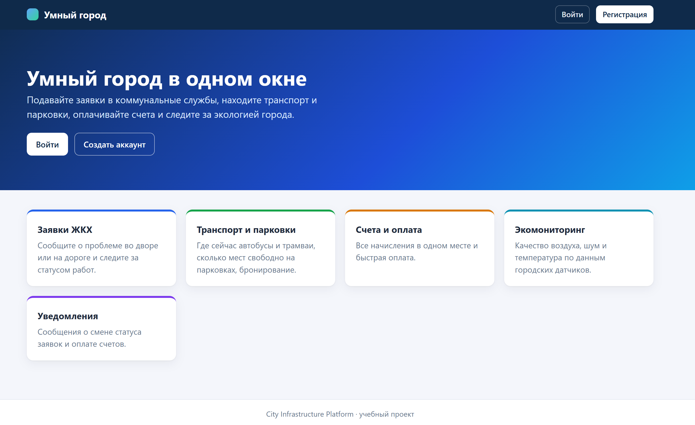

## О проекте

**City Infrastructure Platform** — распределённая система из **шести независимых микросервисов**, которые взаимодействуют только через REST API. Плюс веб-клиент на Thymeleaf.

**Что умеет платформа:**
-  **Transport** — транспорт и парковки, бронирование мест.
-  **Utility** — заявки ЖКХ с уведомлениями.
-  **Environment** — экомониторинг.
-  **Billing** — счета и платежи.
-  **Notification** — уведомления.
-  **Auth** — регистрация, логин, JWT.

**Особенности:**
- Каждый сервис — **своя БД** (MySQL 8.0).
- Взаимодействие — **только HTTP**.
- Авторизация — **JWT** (HMAC-подпись).
- Роли — **USER** и **ADMIN**.

## Команда

| Участник | Зона ответственности |
|---|---|
| **Дарья** | Utility Service + Transport Service |
| **Ксения** | Frontend + Notification Service |
| **Ульяна** | Identity & Auth Service |
| **Александра** | Billing & Payment Service + Environment Service |

## Стек технологий

- **Backend:** Java 17, Spring Boot 4.1.1, Spring Data JPA, Spring Security
- **БД:** MySQL 8.0 (по одному контейнеру на сервис)
- **Авторизация:** JWT (jjwt 0.12.6), HMAC-подпись общим секретом
- **Frontend:** Thymeleaf, HTML, CSS, JS
- **Инфраструктура:** Docker, Docker Compose
- **Сборка:** Maven

## Демонстрация

### Регистрация

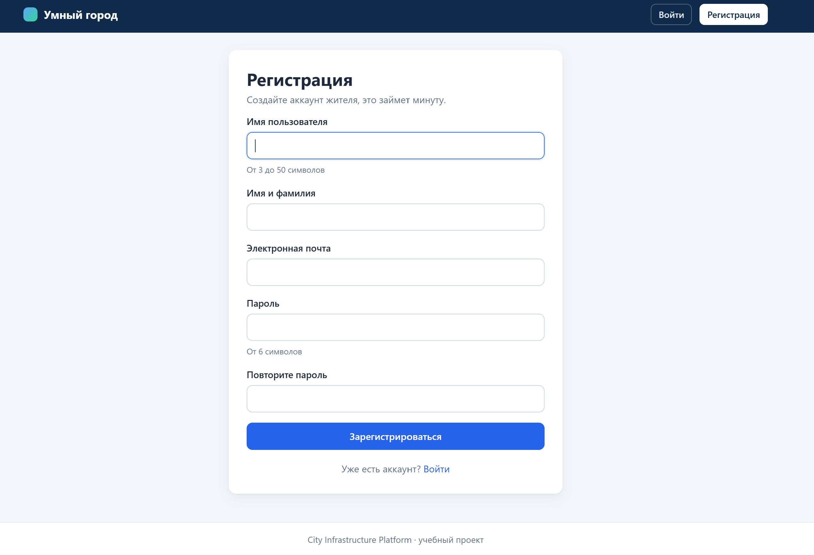

### Заявки ЖКХ

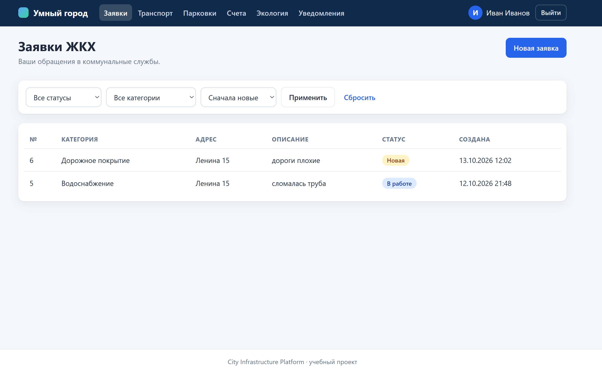

### Транспорт

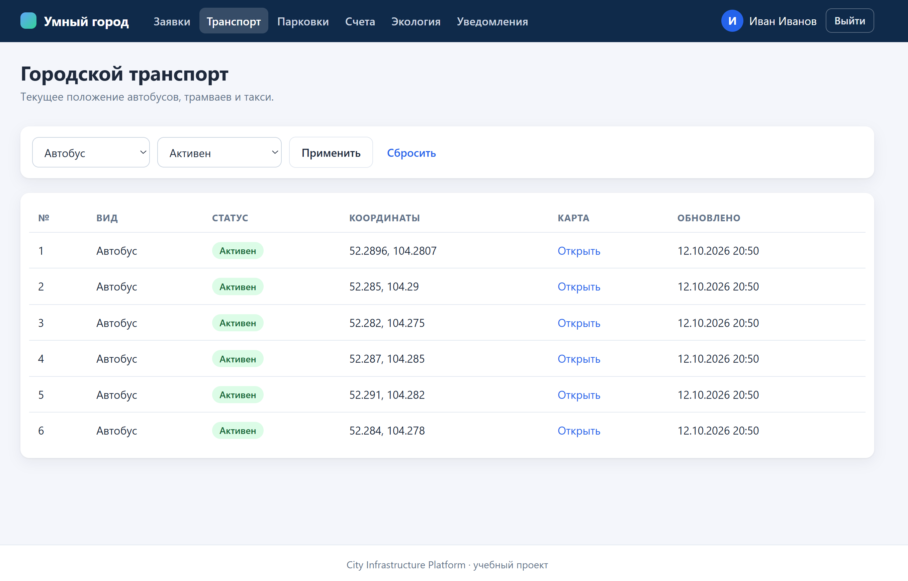

### Парковки

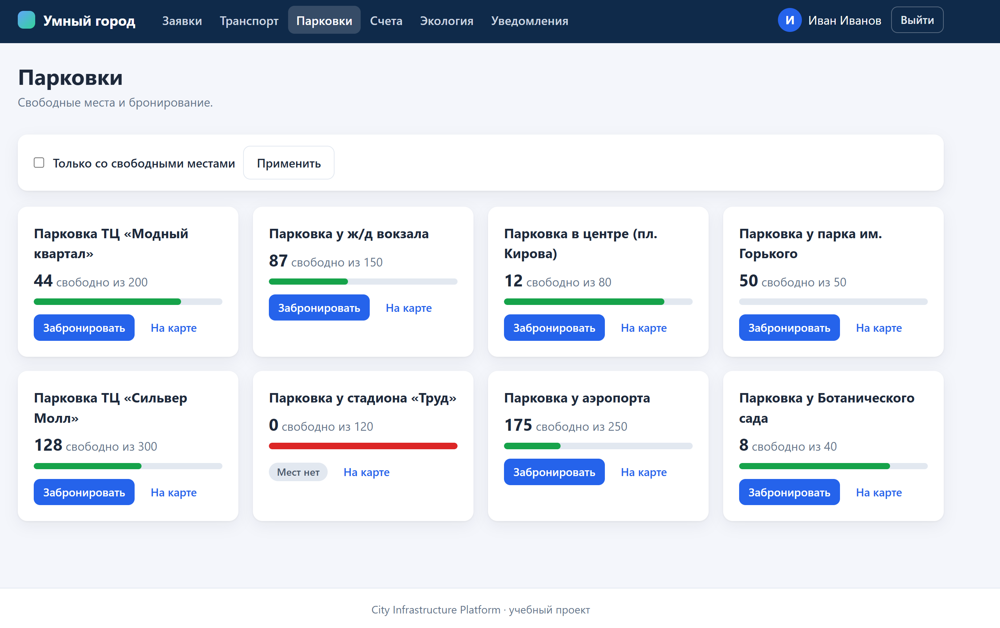

### Счета и оплата

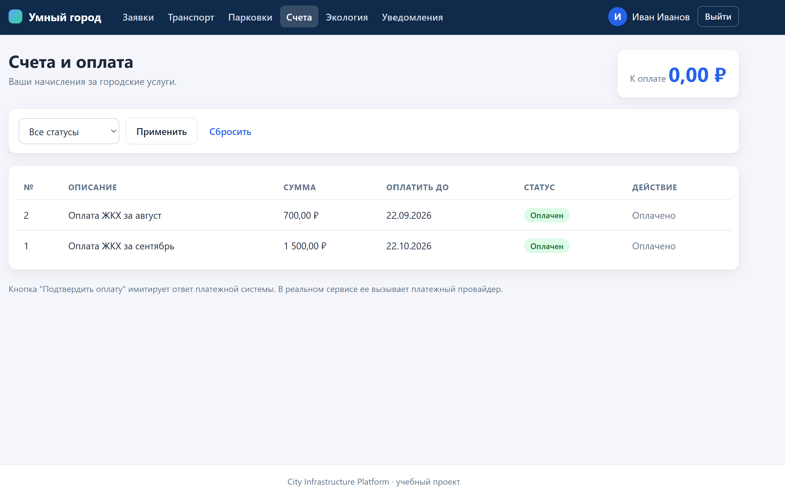

### Датчики экомониторинга

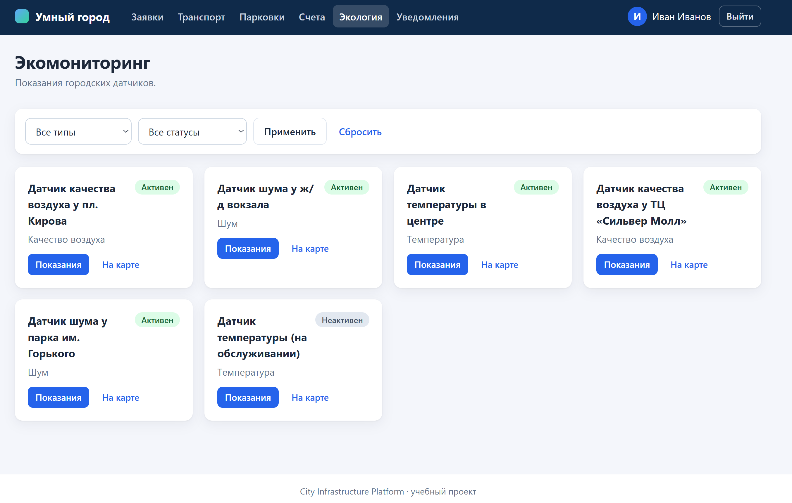

### Уведомления

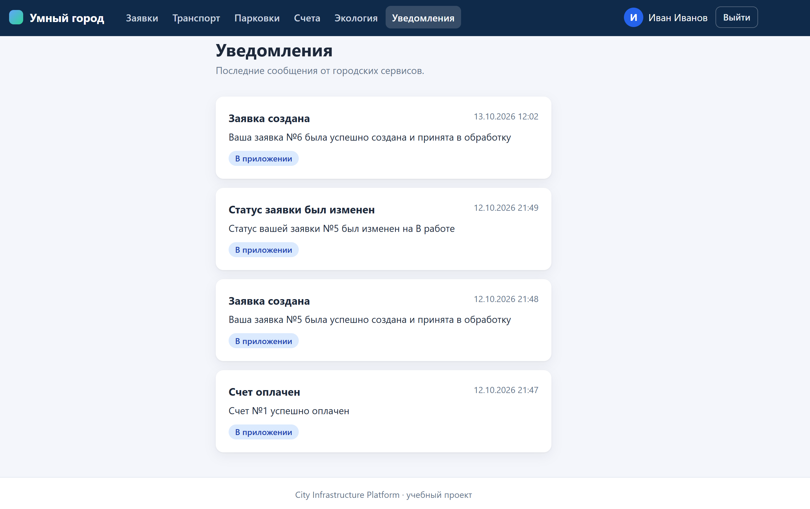

### Роль ADMIN — заявки

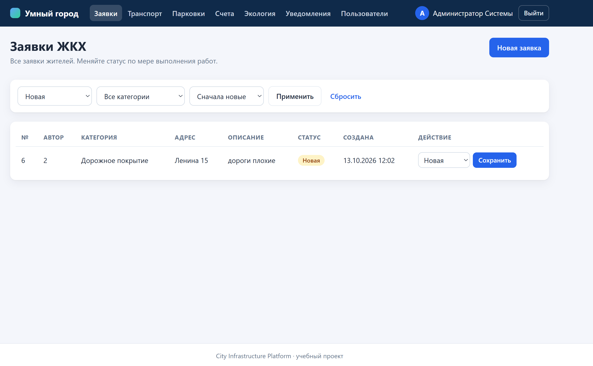

### Роль ADMIN — пользователи

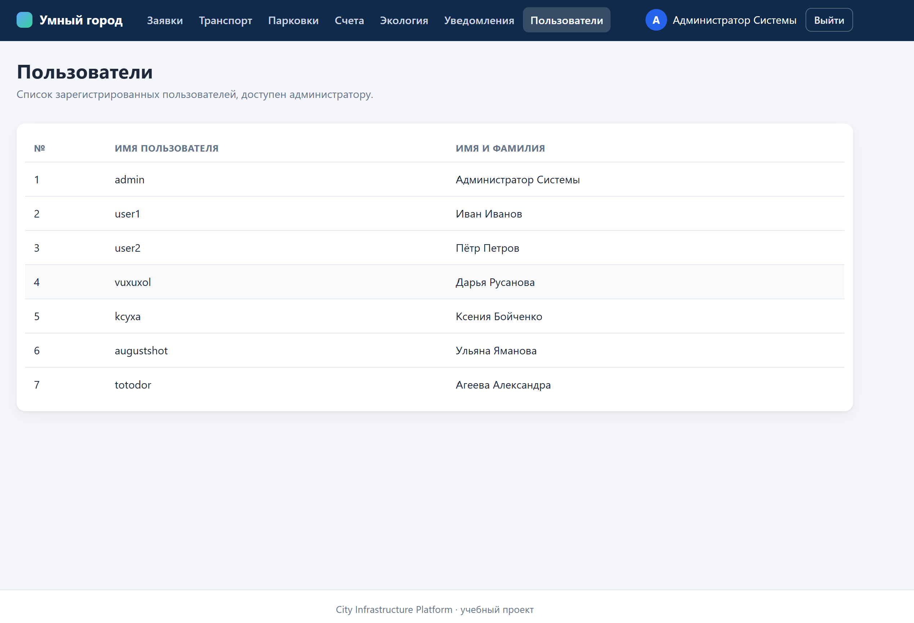

### Роль ADMIN — экомониторинг

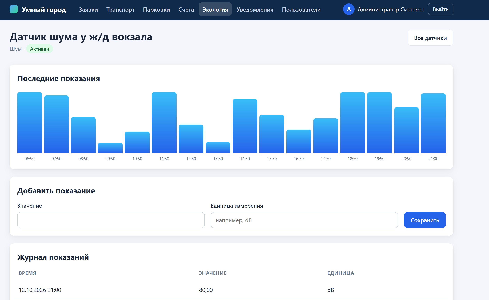


**Внутри Docker-сети** все сервисы слушают порт `8080` и обращаются друг к другу по имени, например `http://utility-service:8080`.

**Межсервисные вызовы:**
- `utility-service` → `notification-service` (`POST /notifications`, fire-and-forget).
- `billing-service` → `notification-service` (при оплате).

**JWT** проверяется локально через общий `JWT_SECRET`.

## Сервисы

| Сервис | Порт | БД | Описание |
|---|---|---|---|
| `frontend` | 8080 | — | Веб-клиент |
| `auth-service` | 8081 | `auth_db` (3311) | Регистрация, логин |
| `transport-service` | 8082 | `transport_db` (3312) | Транспорт, парковки |
| `utility-service` | 8083 | `utility_db` (3313) | Заявки ЖКХ |
| `environment-service` | 8084 | `environment_db` (3314) | Датчики |
| `billing-service` | 8085 | `billing_db` (3315) | Счета, платежи |
| `notification-service` | 8086 | `notification_db` (3316) | Уведомления |

## Быстрый старт

### Требования

- **Docker Desktop** (WSL 2)
- **Git**
- **Java 17** (для локальной разработки)

### Установка

**1. Клонировать репозиторий:**

```bash
git clone https://github.com/Darya-Rusanova/city-infrastructure.git
cd city-infrastructure
```bash
cp .env.example .env
```

Вставить `JWT_SECRET` и `WEBHOOK_SECRET` в .env:

```
JWT_SECRET=ваш-секрет-минимум-32-символа
WEBHOOK_SECRET=ваш-секрет-для-webhook-датчиков
```

**3. Запустить всё:**

```bash
docker-compose up --build -d
```

**4. Открыть в браузере:**

```
http://localhost:8080
```

**Первый запуск** — 5–10 минут.

## Полный список эндпоинтов

### Auth Service (`:8081`)

| Метод | URL | Роли | Описание |
|---|---|---|---|
| `POST` | `/auth/register` | все | Регистрация пользователя |
| `POST` | `/auth/login` | все | Логин, возвращает JWT |
| `GET` | `/users/me` | USER, ADMIN | Свой профиль |
| `GET` | `/users/{id}` | USER, ADMIN | Публичный профиль по ID |
| `GET` | `/users` | ADMIN | Список всех пользователей |

### Transport Service (`:8082`)

| Метод | URL | Роли | Описание |
|---|---|---|---|
| `GET` | `/vehicles` | USER, ADMIN | Список транспорта (фильтры: `type`, `status`, `sortBy`, `dir`) |
| `GET` | `/parking` | USER, ADMIN | Список парковок (фильтры: `available`) |
| `POST` | `/parking/{id}/reserve` | USER, ADMIN | Бронирование парковочного места |

### Utility Service (`:8083`)

| Метод | URL | Роли | Описание |
|---|---|---|---|
| `POST` | `/issues` | USER, ADMIN | Создание заявки ЖКХ |
| `GET` | `/issues` | USER, ADMIN | Список заявок (USER — свои, ADMIN — все) |
| `PUT` | `/issues/{id}` | ADMIN | Смена статуса заявки |

### Environment Service (`:8084`)

| Метод | URL | Роли | Описание |
|---|---|---|---|
| `GET` | `/sensors` | USER, ADMIN | Список датчиков (фильтры: `type`, `status`) |
| `GET` | `/sensors/{id}/data` | USER, ADMIN | Данные датчика |
| `POST` | `/sensors/data` | ADMIN | Добавление показания датчика |

### Billing & Payment Service (`:8085`)

| Метод | URL | Роли | Описание |
|---|---|---|---|
| `GET` | `/accounts/{userId}/invoices` | USER, ADMIN | Счета пользователя (USER — свои, ADMIN — любые) |
| `POST` | `/payments` | USER, ADMIN | Выполнение платежа |
| `POST` | `/payments/webhook/success` | все | Webhook успешной оплаты от провайдера |

### Notification Service (`:8086`)

| Метод | URL | Роли | Описание |
|---|---|---|---|
| `POST` | `/notifications` | внутренний | Создание уведомления (вызывается из других сервисов) |
| `GET` | `/notifications/my` | USER, ADMIN | Уведомления текущего пользователя |
